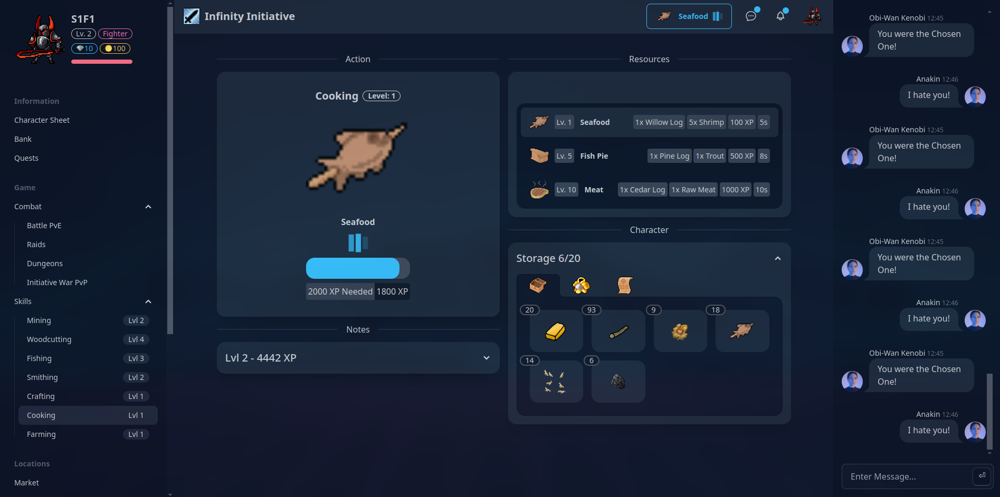
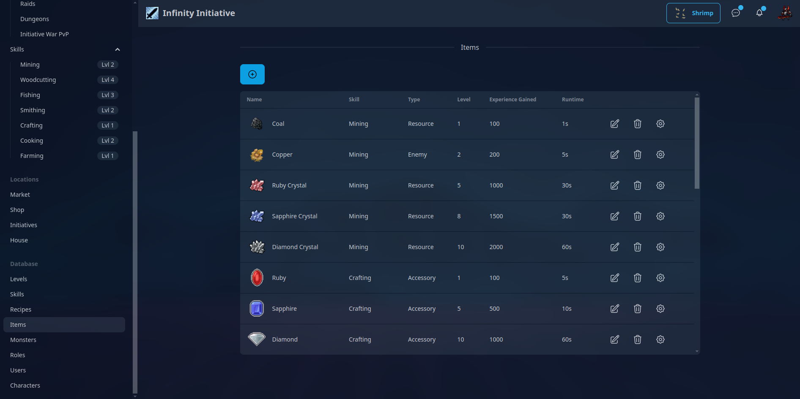

# Infinity Initiative

## A Browser text based fantasy idle MMORPG

### Fully data driven and Open Source!

### Tech Used:
- **Language:** Go
- **Front end Framework:** HTMX
- **Back end Framework:** Echo
- **Realtime Connection:** HTMX partial swaps over HTTP (no websockets/SSE yet)
- **Database:** Sqlite
- **ORM:** Gorm
- **CSS:** Tailwindcss + daisyui (npm required)
- **Pattern:** MVC
- **Tests:** Go Unit tests + Playwright Automated Testing
- **Hot reload:** Air

**Setup Webserver:**
`go mod tidy`

**Run server:**
`make dev`

**Run Tailwind Compiler:**
`npm --prefix tailwindcss install && npm --prefix tailwindcss run dev`

**Run Tests:**
`make test`

**Build Binary for Prod:**
`make build`

